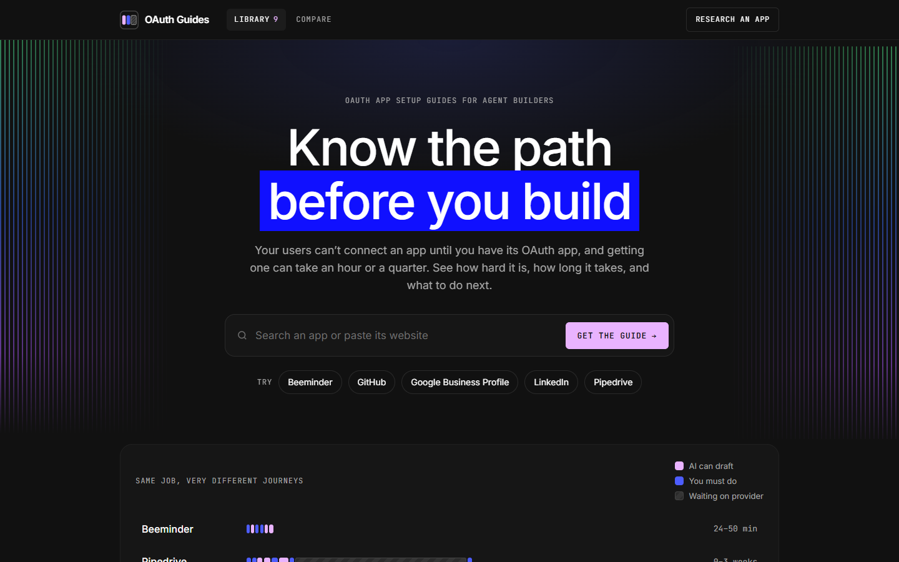
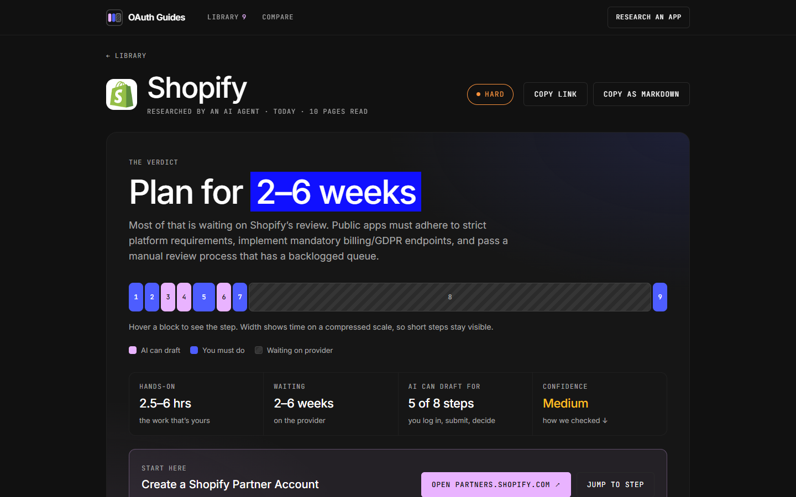
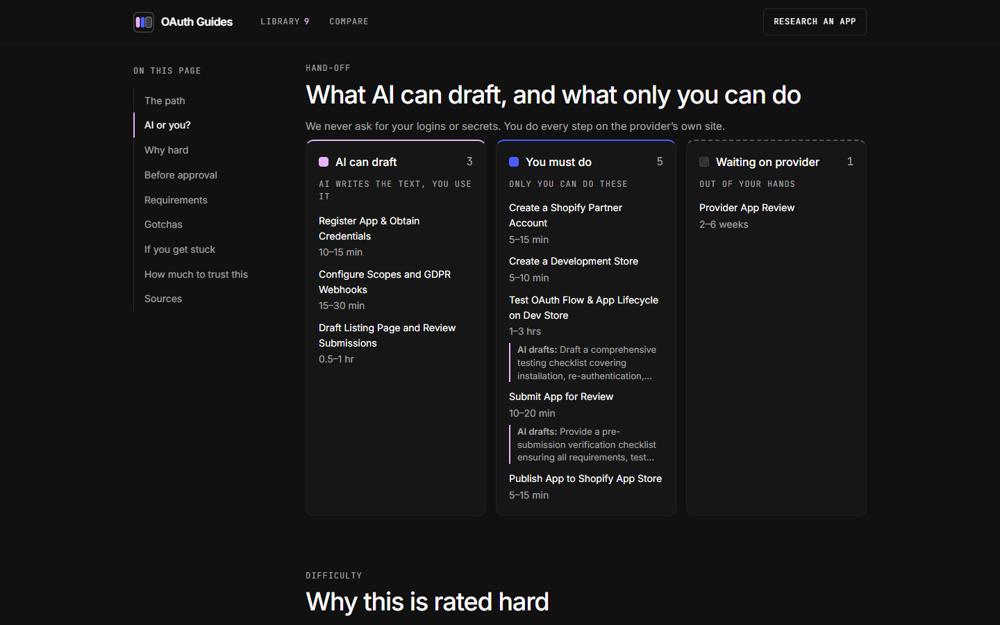
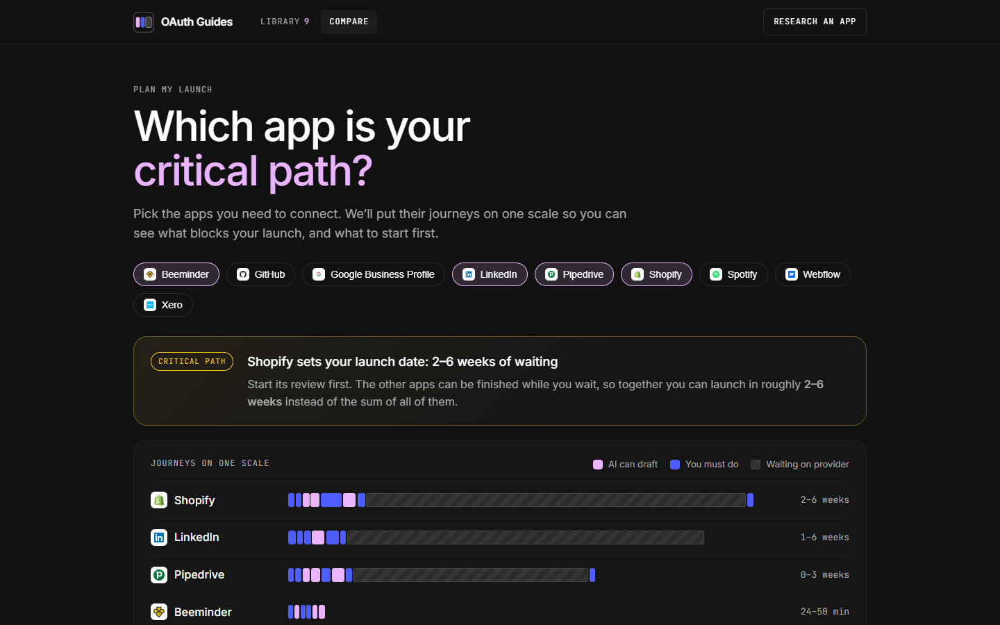

# OAuth Guides

**Know the path before you build.**

Before your users can connect an app, you need its OAuth app, and getting one can take an hour or a quarter. OAuth Guides shows you how hard it is, how long it takes, what blocks approval, and who does what, in one page per app.

Search any app. If it's in the library you get the guide instantly. If not, an AI agent researches it live, writes the guide in about a minute, and gives you a link you can share.

| | |
|---|---|
| **Live app** | https://oauth-guides-o66y.onrender.com/ |
| **Demo video** | https://vimeo.com/1244693576 |
| **Source code** | https://github.com/pavithra2870/OAuth-Guides |

The live app runs on free hosting, so the first load after a quiet spell can take up to a minute while the server wakes up.



## What you get in every guide



- **A verdict up front.** Difficulty (easy, medium, hard, gated) and a plain "Plan for 2–6 weeks".
- **A journey strip.** Every step as a block: hands-on work, AI-assisted work, and waiting on the provider. You can see at a glance that the review wait, not the work, is what sets the date.
- **Who does what.** Each step is marked as something AI can draft, something only you can do (logins, payments, legal, identity), or a wait on the provider. Where AI can help, there's a ready-made prompt to copy.
- **Step by step path** with times, direct links, and a checklist that saves in your browser.
- **Before approval.** What you can already build and test while you wait.
- **Requirements, gotchas and rejection reasons**, with how to fix each.
- **Step zero.** Whether Composio already provides a managed OAuth app for it, in which case you may not need to register your own.
- **Sources.** Every claim links back to the page it came from.
- **Library filters.** Filter by difficulty, or by whether Composio manages the app or you need your own.
- **Fair use, visible.** The search box shows how many live researches you have left today. Library guides are unlimited.



## Plan a launch across several apps

Pick the apps you need to connect and see their journeys on one scale. The slowest approval sets your launch date, so the page tells you which one to start first.



## How it works

```
App name or website
      │
      ▼
 Library hit? ── yes ──▶ Guide (instant)
      │ no
      ▼
 Search (Tavily): official docs first, then a second search limited to the provider's own domains
      │
      ▼
 Read the best pages
      │
      ▼
 LLM writes a structured guide (Gemini, with Groq as fallback)
      │
      ▼
 Code checks every claim against the pages, computes timing, saves it
      │
      ▼
 Shareable guide at /g/<app>
```

The live screen streams each stage as it happens, so you watch the agent work instead of staring at a spinner. If two people ask for the same app, they share one run.

## Key decisions

**The model writes, the code verifies.** The model has to back each claim with a quote from a source. Code then looks for that quote word for word in the page. Each claim gets an evidence level set by code, never by the model:

| Level | Meaning |
|---|---|
| Documented | The quote was found in the provider's own docs |
| Reported | Found only in a non-official source |
| Inferred | No quote could be matched, so it's the agent's reading |
| Tested | Reserved for guides a person has walked through |

Timing is computed in code from the steps too, so the totals always add up.

**Official sources come first.** Forums and user-written pages on a provider's domain don't count as official. A second search restricted to the provider's own domains finds pages a general search misses.

**Time means two things.** Hands-on time (yours and the AI's) and waiting time (the provider's) are shown separately. "Two weeks" of review and "two hours" of work are different problems.

**Honest about the agent.** The guide separates what AI can draft from what a person must do. Steps involving logins, payment, identity or legal agreement are always yours.

**No secrets.** We never ask for your logins or keys. You do each step on the provider's own site.

**Composio catalog, no API key needed.** We snapshotted Composio's public managed-auth list so every guide can say whether a managed app already exists.

**Cheap to run.** Everything runs on free tiers. Keys rotate, models fall back from one to the next, and daily caps keep the live flow fair.

## Stack

- **Frontend:** React, Vite, plain JavaScript, custom CSS (dark theme in the style of Composio)
- **Backend:** Python, FastAPI, server-sent events for live progress
- **Data:** Supabase Postgres when hosted, local SQLite for development (`guides` and `generation_events`); the guides table doubles as the cache
- **Research:** Tavily search and extract
- **Writing:** Gemini, with Groq (`gpt-oss`) as fallback

## Run it locally

You need Python 3.10, Node 18+, and free keys for Gemini, Groq and Tavily. No database setup: locally the app uses a SQLite file and loads the library on first start.

```bash
# 1. Config: copy the template and fill in your keys (never commit .env)
cp .env.example .env

# 2. Backend
python -m venv .venv
source .venv/Scripts/activate        # Windows (Git Bash); on macOS/Linux: source .venv/bin/activate
pip install -r backend/requirements.txt
python backend/scripts/check_connections.py   # confirms the APIs connect
cd backend && uvicorn app.main:app --port 8000   # creates the local database and loads the library

# 3. Frontend (new terminal)
cd frontend
cp .env.example .env                 # VITE_API_URL=http://localhost:8000
npm install
npm run dev                          # http://localhost:5173
```

Generate a guide from the command line:

```bash
python backend/scripts/generate.py "Shopify" --out backend/data/drafts/shopify.json
python backend/scripts/seed.py backend/data/drafts/shopify.json
```

All model names, timeouts and limits are set in `.env`; see `.env.example`.

**Database toggle.** Leave `DATABASE_URL` empty and the app uses a local SQLite file (`backend/data/local.db`). Set it to a Supabase Postgres connection string and the same code uses Postgres instead, which is what the hosted version runs on. For Postgres, run `python backend/scripts/migrate.py` once to create the tables, then `python backend/scripts/seed.py` to load the library.

## Project layout

```
backend/app/        pipeline, prompts, verification, LLM and search clients, API routes
backend/scripts/    connection checks, migrations, guide generation and seeding
backend/data/       Composio catalog snapshot and the library's guide files
frontend/src/       pages, components, and the journey-strip logic
docs/screenshots/   images used in this README
```

## What's in the library

Beeminder, GitHub, Google Business Profile, LinkedIn, Pipedrive, Shopify, Spotify, Webflow and Xero: a mix chosen to show the range, from a 30-minute self-serve setup to multi-week reviews.

## Good to know

- Guides are built from public documentation. They tell you what the provider's docs say and how sure we are. Confirm anything critical on the provider's site before you submit.
- Each guide shows its research date and the pages it read.
- Apps that have been renamed (for example Twitter/X) work best when you enter the website address.

## Where this could go next

- A "draft this for me" button that fills in your app description, scope justification and privacy policy from your use case.
- A browser agent that fills in the registration forms and hands over to you at login and payment.
- Scheduled re-research so guides refresh when provider rules change.
